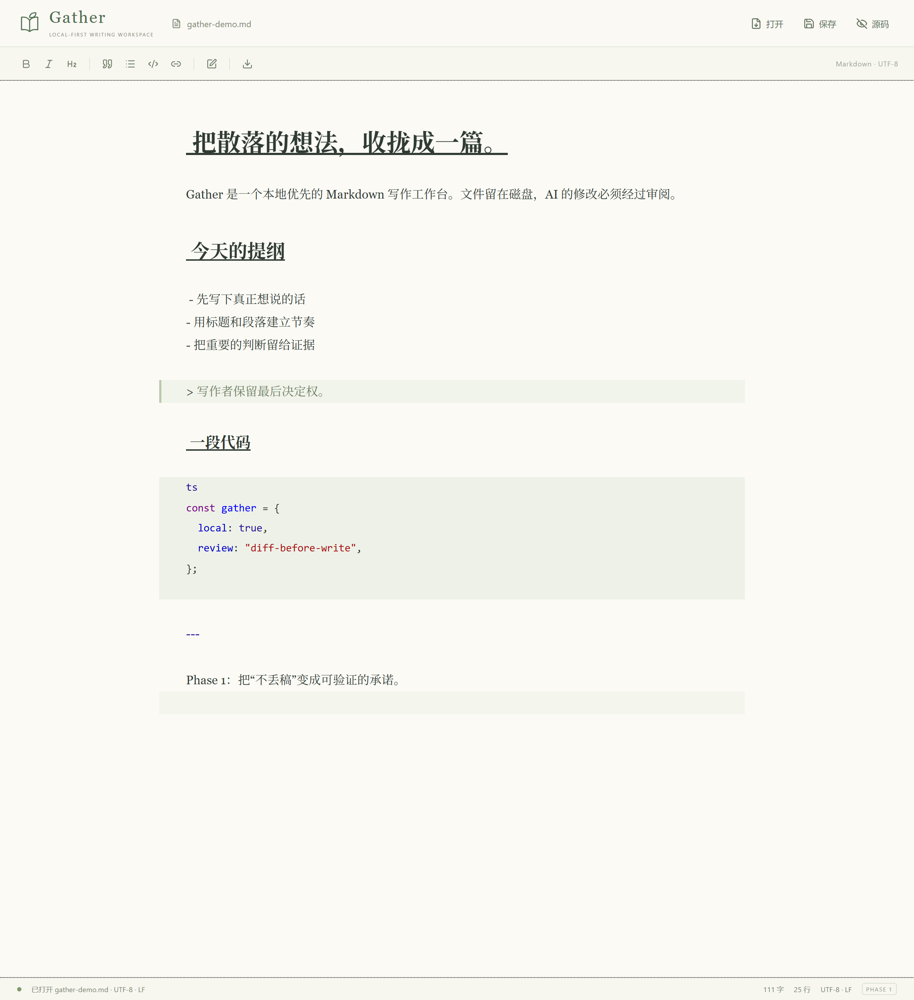
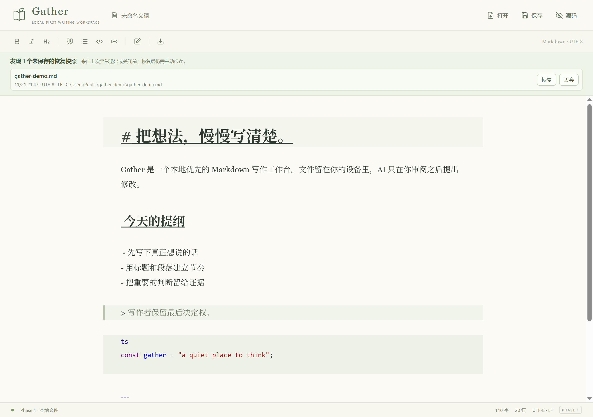
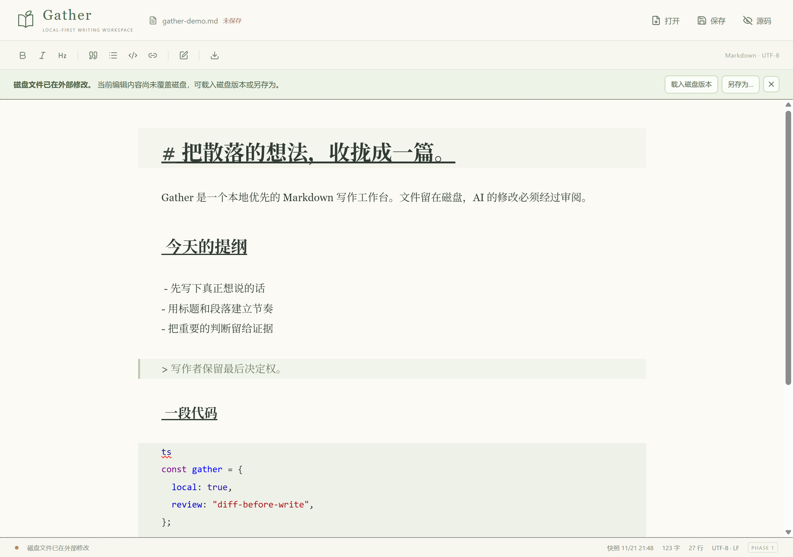
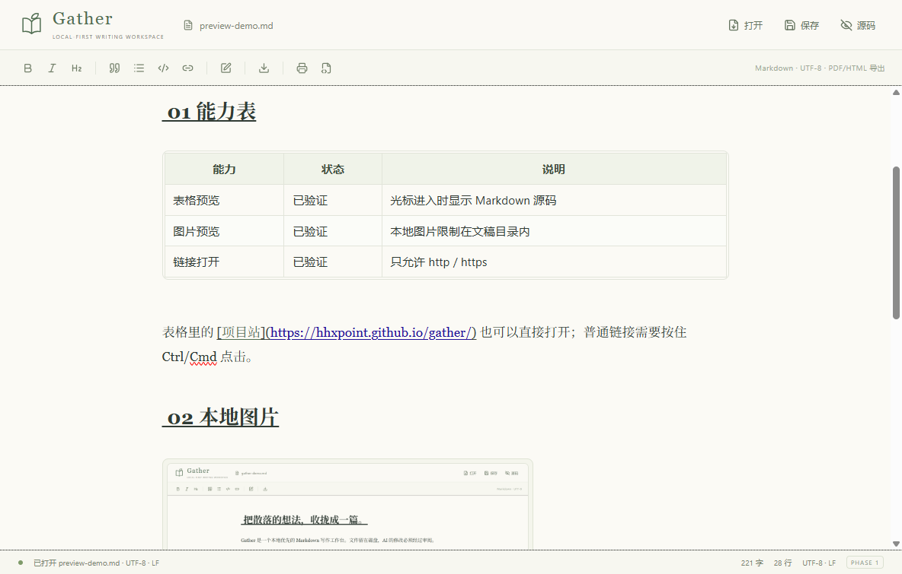
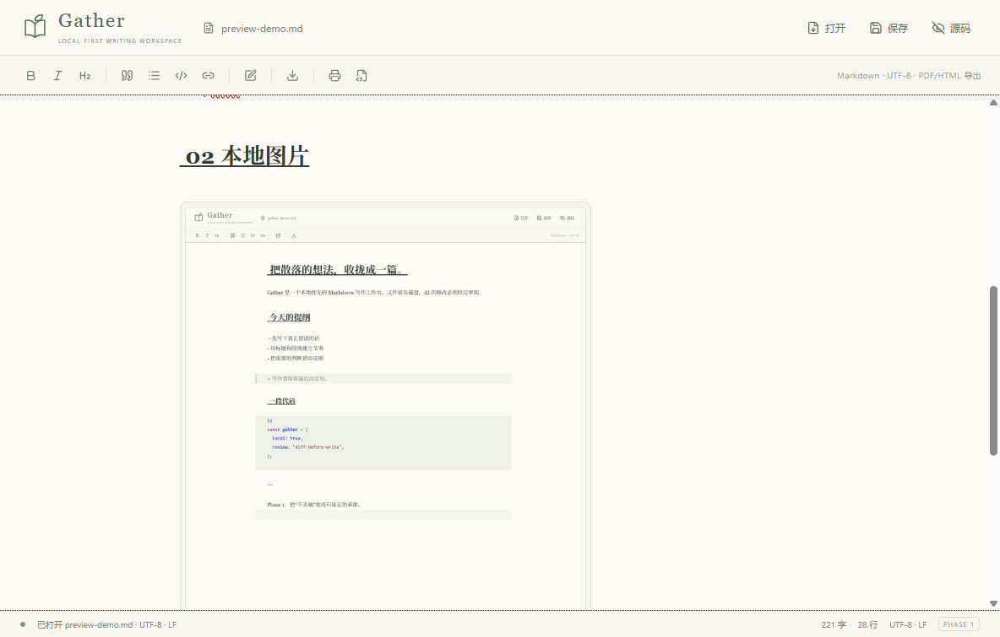
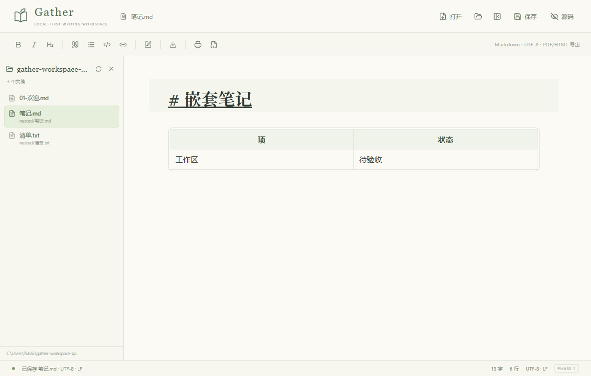
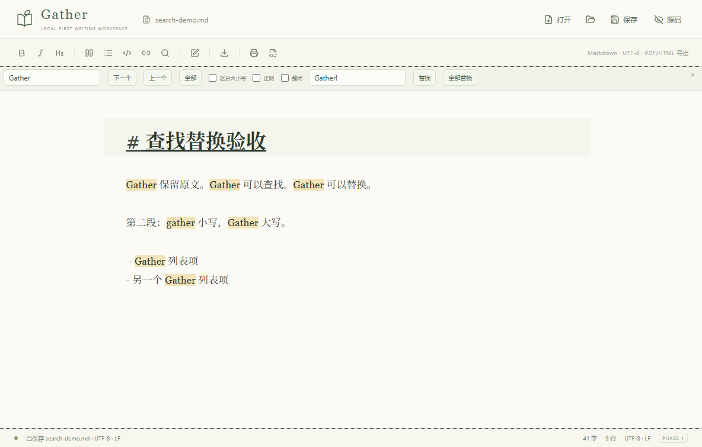
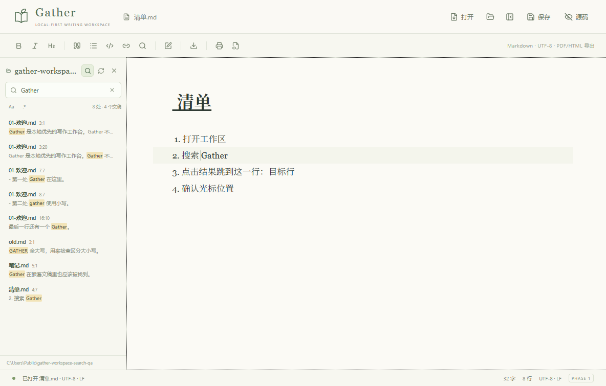
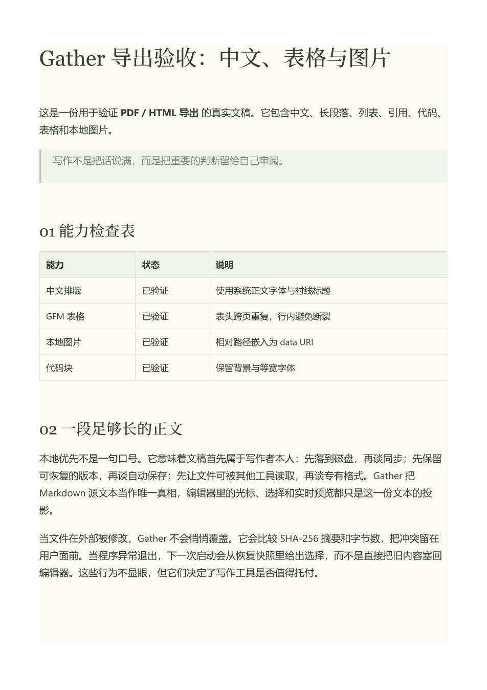

# Gather

[](https://github.com/hhxpoint/gather/actions/workflows/ci.yml)

> 本地优先、AI 修改可审阅的 Markdown 写作工作台。

Gather 把 Markdown 文件留在你的磁盘上，把编辑器的最终决定权留给你。它不把文稿锁进云端数据库，也不让模型在后台悄悄改写正文。当前阶段先把本地文件、编辑器内核与“不丢稿”做成可复查的工程基础，再接入 AI 审阅。

**当前状态：Phase 1 文件可靠性主线已落地，并补上了真实界面、文件夹工作区、表格/图片实时预览、桌面 PDF/HTML 导出、仓库内调试日志与 Windows staging 目录包。** 仓库为 [hhxpoint/gather](https://github.com/hhxpoint/gather)，项目站为 [hhxpoint.github.io/gather](https://hhxpoint.github.io/gather/)，版本号仍为 `0.1.0-phase.0`。已完成 **CRLF/BOM 保真、保存冲突拒绝、撤销栈重置、CSP/导航、自动恢复快照、强杀恢复、实时外部变更、故障注入与错误映射**，并产出未签名 Windows staging 目录包，实测 `Gather.exe` 可打开/保存。桌面端可以打开一个文件夹作为工作区，递归列出 Markdown 文稿并在侧栏切换；切换脏文稿前会确认。编辑器现在会把 GFM 表格与文档目录内的本地图片呈现在源码旁，点击即可回到源码；外链只允许经主进程校验的 http/https。桌面端还可以从当前编辑器内容导出 **A4 PDF 或含本地图片的独立 HTML**。**仍没有签名安装包、公开 beta，也没有完成 IME/Linux 桌面矩阵、完整版本历史/冲突合并、真实断电/满盘矩阵、AI/RAG 或 DOCX。** 文中区分“代码中存在”“已验证”“尚未验证”，不把计划写成结果。

## 目录

- [真实界面](#真实界面)
- [项目状态](#项目状态)
- [为什么做 Gather](#为什么做-gather)
- [当前能力](#当前能力)
- [明确未完成项](#明确未完成项)
- [技术架构](#技术架构)
- [目录结构](#目录结构)
- [本地运行](#本地运行)
- [CLI 示例](#cli-示例)
- [路线图](#路线图)
- [P0 编辑功能清单](#p0-编辑功能清单)
- [工业级质量门槛](#工业级质量门槛)
- [Windows / Linux 分发与签名成本](#windows--linux-分发与签名成本)
- [GitHub Pages 项目站](#github-pages-项目站)
- [调试与验证记录](#调试与验证记录)
- [贡献](#贡献)
- [安全与隐私](#安全与隐私)
- [License](#license)
- [Trademark 注意](#trademark-注意)

## 真实界面

以下截图来自 Phase 1 的 Windows 构建，不是效果图。示例文稿与公开示例路径均为合成内容。



*Markdown 原文是唯一真相；标题、引用与代码块由装饰层呈现，不产生第二份文档模型。*

| 崩溃恢复快照 | 外部修改拦截 |
| --- | --- |
|  |  |
| 强杀进程后重启，未保存内容仍在；恢复后仍需主动保存。 | 外部程序改写文件时保存会被拒绝，由你决定载入磁盘还是另存为。 |

| Markdown 表格预览 | 本地图片预览 |
| --- | --- |
|  |  |
| 光标离开时表格以 HTML 呈现；点击表格立即回到源码。 | 相对路径图片经主进程目录校验后显示；点击图片回到 ``。 |



*打开一个文件夹就是工作区：侧栏递归列出 Markdown 文稿，嵌套路径可见；切换前确认未保存内容。*



*查找/替换面板使用中文文案，支持上一个/下一个、全部选中、区分大小写、正则、整词与全部替换；匹配在正文中高亮。*



*工作区搜索在独立工具进程中扫描：结果列出文件、行列与高亮预览；点击命中打开对应文稿并把光标放到目标行。*



*真实导出的 A4 PDF（4 页合成文稿）由 `pdfjs-dist` 渲染回图像核验：中文、表格、代码块与本地图片都在；不是 HTML 效果图。*

更多截图与项目叙事见 [项目站](https://hhxpoint.github.io/gather/#product)。工程证据：[CI](https://github.com/hhxpoint/gather/actions/workflows/ci.yml)、[DEBUG_LOG](docs/DEBUG_LOG.md)、[VERIFICATION](docs/VERIFICATION.md)、[ADR 0001–0010](docs/adr)。跨批次的工程方法与踩坑索引见 [工程手册](docs/PLAYBOOK.md)。

## 项目状态

| 项目 | 现状 |
| --- | --- |
| 阶段 | Phase 1（文件可靠性进行中；Phase 0 骨架与 CI 已闭环） |
| 版本 | `0.1.0-phase.0`（公开源码仓库；有未签名 staging，未发布签名安装包或 npm 包） |
| 目标平台 | Windows 10/11；Linux（Ubuntu/Debian/Fedora，X11 与 Wayland） |
| 桌面壳 | Electron 38 + electron-vite 4（Phase 0 默认） |
| 编辑器核心 | CodeMirror 6 + Lezer |
| CLI | Node.js + Commander，`gather doctor/export/new` |
| 共享核心 | `@gather/core`：Markdown 渲染、文本计数、CRLF/BOM 格式检测 |
| 许可 | 应用核心 AGPL-3.0-only（`LICENSE` 已落盘）；插件 SDK/主题以后 MIT |
| 仓库与站点 | [github.com/hhxpoint/gather](https://github.com/hhxpoint/gather) 公开；[hhxpoint.github.io/gather](https://hhxpoint.github.io/gather/) 已部署 |
| CI | [Windows + Ubuntu matrix](https://github.com/hhxpoint/gather/actions/workflows/ci.yml) 已产生绿色运行 |
| 发布状态 | 没有签名安装包或公开 beta；有 Windows 未签名 staging 目录包（内部验证，默认图标）；项目站已更新为 Phase 1 展示 |

Phase 0 的退出标准不是“功能多”，而是“每一层都能从干净环境跑起来，并且不丢稿”。当前已经做到：干净环境 `npm ci`、类型检查、测试、构建、CLI 冒烟在 Windows 与 Ubuntu CI 通过；桌面打开与另存为在 Windows 实际写盘成功；项目站公网可访问。Phase 1 文件安全主线已闭环：LF/CRLF/BOM 可字节保真 round-trip；保存前用 SHA-256 + 尺寸拒绝覆盖外部修改；打开新文件会重建编辑器状态，撤销不会回到上一篇；生产环境注入 CSP 并拦截导航/新窗口；自动恢复快照在强杀后可恢复，实时 watcher 会提示外部修改并支持显式载入磁盘版本；写入/重命名/权限失败会清理临时文件并显示可操作错误；POSIX 只读目录与 20 MiB 边界进入真实/注入测试；Windows staging 目录包已实测打开/保存。桌面端 PDF/HTML 导出已在真实窗口实际导出并回渲染核验，包括中文、表格、代码块和相对路径本地图片。实时预览已补上 GFM 表格、文档目录内图片与安全外链：点击表格/图片回源码，普通链接 Ctrl/Cmd+点击或表格链接单击，主进程只放行 http/https。仍未做到：IME/Linux 桌面矩阵、完整的冲突合并/版本历史、真实断电/满盘矩阵、签名安装包、AI/RAG、DOCX。具体差距见[明确未完成项](#明确未完成项)；本文档不声称这些能力已完成。

## 为什么做 Gather

**文件应该是文件。** 很多写作工具把内容存进私有数据库或云端工作区，导出只是事后补救。Gather 反过来：`.md` 文件是唯一真相，应用只是文件的编辑器。换一台机器、换一个编辑器、用 `git` 管理版本，文稿都还在。

**AI 不应该替作者做决定。** 常见的“AI 改稿”是一键重写，用户只能接受一个黑箱结果。Gather 的方向是：模型提出修改，界面展示逐块 diff，作者逐块接受或拒绝；没有审阅就不落盘。AI 是建议者，不是共同作者。

**Markdown 不需要被藏起来。** 富文本编辑器很舒服，但它们通常有自己的文档模型，保存时把 Markdown 重新序列化，脚注、表格、HTML、空行和换行符很容易被改写。Gather 直接编辑 Markdown 文本，实时预览只是文本上的装饰层，不是另一份文档。

Gather 不打算做这些事：

- 不做云端协作 SaaS，不要求账号，不做多人实时协同（至少 Phase 0–2 不做）。
- 不做 Notion 式块数据库，不引入私有文档格式。
- 不内置付费模型 API，不把“上传文档”当作默认行为。
- 不承诺“AI 自动写完一篇文章”。审阅是产品约束，不是可关闭的选项。

## 当前能力

状态图例：

- **已落盘**：代码在工作区中存在。
- **已验证（本地）**：在 2026-11-21 的 Windows + Node 24.22.3 环境中实际执行通过；不代表 CI 或跨平台通过。
- **部分**：有实现，但覆盖范围或边界处理不完整。
- **未实现**：当前阶段范围外，或尚未开始。
- **未验证**：代码存在，但没有完成对应验证（例如 IME、Linux 图形会话、异常写盘矩阵），不能声称通过。

### 桌面应用（`apps/desktop`）

| 能力 | 状态 | 说明 |
| --- | --- | --- |
| Electron 主窗口 | 已验证（本地 Windows） | 1200×820，最小 760×520，单实例锁；生产构建可加载 |
| 打开 Markdown | 已验证（本地 Windows） | 系统文件对话框打开仓库内 Markdown 并渲染成功 |
| 文件夹工作区 | 已验证（本地 Windows） | 目录对话框打开工作区，递归列出 Markdown/TXT（最多 2000 个、深度 8），跳过隐藏目录、`node_modules`、构建目录与符号链接；侧栏切换、刷新、关闭；切换脏文稿前确认；打开文件时再次做目录边界校验 |
| 工作区搜索 | 已验证（本地 Windows + 单元测试） | `Ctrl/Cmd+Shift+F` 在独立 `utilityProcess` 扫描当前文件夹；`Gather` 返回 8 处 / 4 个文稿，区分大小写 6 处 / 3 个文稿，正则日期 2 处 / 2 个文稿；200 条结果、2 MiB 单文件、64 MiB 总量、8 秒超时；点击结果打开文稿并跳到行列 |
| 会话恢复 | 已验证（本地 Windows + 单元测试） | 窗口位置/尺寸/最大化跨重启恢复；最近工作区与最后文稿自动恢复；根目录/文稿缺失时降级；关闭工作区清除会话；强杀后恢复快照横幅仍出现 |
| 保存 / 另存为 | 已验证（本地 Windows） | 保留 LF/CRLF 与 BOM；临时文件写入 + `fsync` + `rename`；另存为恢复路径已验证 |
| 导出 PDF / HTML | 已验证（本地 Windows） | 使用当前编辑器内容；隐藏窗口 `printToPDF` 输出 A4，中文/表格/代码块/本地图片进入 PDF；HTML 中本地图片嵌入为 data URI（远程图片仍保留原 URL）；原子写目标文件，失败不保留半个导出文件 |
| 本地图片嵌入 | 已验证（本地 + 单元测试） | 相对路径 `png/jpg/jpeg/gif/webp/avif/bmp` 限制在文稿目录内并转 data URI；目录外绝对路径、SVG、缺失文件与超预算图片只告警，不阻止导出 |
| 外部修改保护 | 已验证（本地 Windows） | 保存前比较 SHA-256/尺寸；冲突时拒绝覆盖，可载入磁盘版本或另存为 |
| 实时外部变更提示 | 已验证（本地 Windows） | 目录 watcher + 2 秒 stat 轮询；内容 SHA-256 确认后提示，删除也会提示 |
| 自动恢复快照 | 已验证（本地 Windows） | 停止输入约 2.2 秒或持续编辑 15 秒后写入 userData；原子写入、最多 20 份 |
| 崩溃恢复 | 已验证（本地 Windows） | 强杀后重启显示恢复横幅；恢复路径/未命名文稿并“尚未保存”，保存或丢弃后清理 |
| 磁盘重载 | 已验证（本地 Windows） | 外部修改后可显式载入磁盘版本；未保存修改需确认，恢复快照随后重建 |
| 写入失败清理 | 已验证（注入测试） | ENOSPC/EIO/EACCES、sync/close/rename 失败会清理临时文件，不替换原文件 |
| 错误提示 | 已验证 | ENOSPC/EACCES/EPERM/EROFS/EBUSY/ENOENT/EIO 映射为中文可操作提示；IPC 前缀会清理 |
| 文件大小保护 | 已验证边界 | 单文件上限 20 MiB；读取超限、CRLF 编码膨胀超限都拒绝；POSIX 只读目录真实 EACCES 在 Ubuntu CI 通过，Windows 跳过 |
| 进程隔离 | 已落盘 | `contextIsolation: true`、`sandbox: true`、`nodeIntegration: false` |
| 应用菜单 | 已验证（菜单结构） | 文件、编辑、视图、帮助菜单；打开/文件夹/保存/另存为/导出、查找/替换/工作区查找、预览切换；新增编辑菜单已在真实窗口显示 |
| 快捷键 | 部分验证 | `Ctrl/Cmd+O`、`Ctrl/Cmd+S`、`Ctrl/Cmd+Shift+O`、`Ctrl/Cmd+Shift+F`、`Ctrl/Cmd+F`、`Ctrl/Cmd+H` 已实际操作；Shift+S / Shift+P / Shift+E 未逐项实测 |
| 未保存提示 | 部分 | 标题栏脏标记、打开其他文件前确认、`beforeunload`；恢复快照见上一行 |
| CSP 与导航防护 | CSP 已验证，导航已落盘 | 生产 `file://` 响应注入 CSP，内联脚本实测被阻止；新窗口/跨页导航被拦截 |

### 编辑器（`packages/editor`）

| 能力 | 状态 | 说明 |
| --- | --- | --- |
| CodeMirror 6 源码编辑 | 已落盘 | Markdown 语法、行号隐藏、自动换行、Tab 缩进 |
| GFM 解析 | 已落盘 | 使用 `@codemirror/lang-markdown` 与语言数据 |
| 撤销 / 重做 | 已验证（本地 Windows） | CodeMirror history；外部输入不污染撤销栈 |
| 打开新文件重置撤销栈 | 已验证（本地 Windows） | 打开 `lf.md` 后 Ctrl+Z 不会回到上一篇 `crlf-bom.md` |
| 搜索 / 替换 | 已验证（本地 Windows） | `Ctrl/Cmd+F` 打开中文查找面板，`Ctrl/Cmd+H` 聚焦替换；支持上一个/下一个、全部、区分大小写、正则、整词、替换与全部替换；替换走 CodeMirror transaction，撤销恢复原文 |
| 实时预览装饰 | 已验证（本地 Windows） | 标题、粗体、斜体、行内代码、链接、引用、代码块、列表、GFM 表格与图片装饰；光标所在行显示语法标记 |
| 实时预览开关 | 已验证（本地 Windows） | 通过 Compartment 动态启用/停用装饰；源码/实时预览切换已实际操作 |
| 格式工具栏 | 已落盘 | 粗体、斜体、二级标题、引用、列表、行内代码、链接、代码块 |
| 中文/英文计数 | 已落盘 | `countText` 统计字符、词、行；CJK 按字计数 |
| 表格预览 | 已验证（本地 Windows） | GFM 表格以只读 widget 呈现；光标进入或点击表格回到源码；超过 1.5 MiB 的文稿与超过 50k 字符的单个表格自动退回源码 |
| 图片预览 | 已验证（本地 Windows） | 相对路径位图经主进程 `realpath` 目录边界、格式与 8 MiB 上限校验后以 data URI 呈现；点击回到源码；远程图片不自动加载 |
| 链接打开 | 已验证（本地 Windows + 单元测试） | 普通链接 `Ctrl/Cmd+点击`、表格链接单击；主进程只放行 http/https，拒绝 `javascript:`/`file:`/凭据链接；非法值显示错误 |
| 输入法兼容性验证 | 未验证 | 没有 Windows/Linux IME 测试记录 |

### CLI（`packages/cli`）

| 命令 | 状态 | 说明 |
| --- | --- | --- |
| `gather doctor` | 已验证（本地 + 双平台 CI） | 输出 Node、平台、工作目录；`--json` 输出结构化结果；Windows 与 Ubuntu CI 均执行 |
| `gather export <file>` | 部分（本地验证） | CLI 仅支持 HTML；桌面端另有 PDF/HTML 导出，CLI 的 PDF/DOCX 会明确报错；本地 `--out` 写盘成功，CI 未覆盖 export |
| `gather new <file>` | 已验证（本地） | 父目录必须存在；`wx` 模式拒绝覆盖已有文件；CI 未覆盖 new |
| 全局安装 | 未实现 | 没有发布 npm 包；Phase 0 通过仓库内路径运行 |

### 共享核心（`packages/core`）

- `renderMarkdown`：`marked` 解析 + `sanitize-html` 白名单过滤，禁止 `javascript:` 链接，图片允许 `http/https/data`。
- `renderDocumentHtml`：生成带打印样式的中文友好 HTML 文档。
- `countText`：字符、拉丁词、CJK 字、行数。
- 核心不依赖 Electron，CLI 与桌面端共用。

### 测试与站点

| 项目 | 状态 | 说明 |
| --- | --- | --- |
| 单元测试源码 | 部分 | `packages/core/test/*.test.ts`、`packages/editor/test/*.test.ts`、`apps/desktop/test/*.test.ts` |
| 测试运行器配置 | 已落盘 | `vitest.config.ts` 匹配 `packages/**/test/**/*.test.ts` 与 `apps/desktop/test/**/*.test.ts` |
| 测试实际执行 | 已通过（本地 + CI） | 本地 Electron Node 22：15 个测试文件、121 个测试，119 通过、2 个 POSIX-only 跳过；会话批次 PR CI [45109905613](https://github.com/hhxpoint/gather/actions/runs/45109905613) 与 main CI [45110083947](https://github.com/hhxpoint/gather/actions/runs/45110083947) 均为 Ubuntu 121 全过、Windows 119 通过 + 2 跳过 |
| 文件 I/O 测试 | 已通过 | 临时目录真实写盘：BOM+CRLF round-trip、外部修改拒绝、文件删除拒绝、Save As、混合行尾归一、20 MiB 边界 |
| 导出 HTML 测试 | 已通过 | data URI 嵌入、URL 编码文件名、目录外路径拒绝、SVG/缺失图片告警、代码块不误处理、远程/data 图片不触碰、文稿目录消失告警、文件名清洗 |
| 预览与链接测试 | 已通过 | 图片/链接语法解析、http/https 判定、本地图片解析/目录逃逸/缺失/缓存、外链协议/凭据/格式拒绝 |
| 工作区测试 | 已通过 | 递归列出 Markdown/TXT、跳过隐藏/构建/依赖目录、排序、目录边界、绝对路径/穿越/缺失/目录拒绝 |
| 恢复与 watcher 测试 | 已通过 | 快照写入/列表/读取/覆盖/丢弃/损坏文件/写删串行；外部修改、自写忽略、删除与重建、轮询差异 |
| 故障注入测试 | 已通过 | ENOSPC/EIO/EACCES、sync/close/rename 失败、临时文件清理、旧快照保留、错误映射与 IPC 前缀 |
| 类型检查 | 已通过（本地 + CI） | 四个 workspace 的 `tsc --noEmit` 本地通过；导出批次 [44917922628](https://github.com/hhxpoint/gather/actions/runs/44917922628) 双平台通过 |
| CLI 冒烟 | 已通过（本地 + CI 部分） | 本地：`doctor/new/export --out`（HTML）成功，`--format pdf` 非零退出；CI：双平台 `doctor --json` 通过 |
| 构建产物 | 已通过（本地 + CI） | 本地 `apps/desktop/out`、`apps/site/dist`、`packages/cli/dist`；CI 双平台完整构建通过 |
| CI | 已通过 | `.github/workflows/ci.yml` 覆盖 Ubuntu 与 Windows，Node 24；工作区批次 [44983062214](https://github.com/hhxpoint/gather/actions/runs/44983062214)、合并后 main [44983351330](https://github.com/hhxpoint/gather/actions/runs/44983351330)、预览批次 [44974544499](https://github.com/hhxpoint/gather/actions/runs/44974544499)、导出批次 [44917922628](https://github.com/hhxpoint/gather/actions/runs/44917922628) 均全绿 |
| 官网 | 已部署 | `apps/site` 构建成功；工作区批次 Pages [44983351367](https://github.com/hhxpoint/gather/actions/runs/44983351367) 成功；公网 HTML/CSS 与本地构建 SHA-256 一致，6 张产品截图与 PDF 截图 HTTP 200 |
| 安装包 | 部分 | electron-builder NSIS/portable 未产出（第二次远程工具请求超时）；Windows staging 目录包已产出并实测；无签名、默认图标、无安装器 |

## 明确未完成项

这一节区分“骨架已闭环”“Phase 1 文件可靠性已证明”和“产品可发布”。勾选项是已经完成并有证据的；未勾选项都是 beta 之前的阻断，其中任何“必须”级编辑能力缺失，都不能把当前状态描述成完整编辑器。

- [x] **Windows/Ubuntu CI 已复跑。** 导出批次 [44917922628](https://github.com/hhxpoint/gather/actions/runs/44917922628) 在 `ubuntu-latest` 与 `windows-latest` 上执行 `npm ci`、typecheck、75 个测试、build 与 CLI `doctor --json`，全部成功；Ubuntu 75 全过，Windows 73 通过 + 2 个 POSIX-only 跳过。上一批基线为 [44888732915](https://github.com/hhxpoint/gather/actions/runs/44888732915)（65 个测试）。
- [x] **项目站已部署。** Pages 工作流 [44870544823](https://github.com/hhxpoint/gather/actions/runs/44870544823) 成功；`https://hhxpoint.github.io/gather/` 已在浏览器中验证加载，CSS 正常。
- [x] **桌面打开/另存为已在 Windows 实际验证。** 打开仓库内 Markdown、另存为文件，并切换源码/实时预览；这不是完整 IME 或 Linux 矩阵。
- [x] **CRLF/BOM 已可字节保真。** 真实窗口中打开 BOM + CRLF 文稿，保存后 42 字节逐字节一致；LF、无结尾换行也由单元测试覆盖。混合行尾会在保存时统一为 LF，界面会显示“混合行尾”。
- [x] **打开新文件会重置撤销栈。** 真实窗口中编辑 `crlf-bom.md` 后打开 `lf.md`，Ctrl+Z 不会回到上一篇；编辑器改为重建 `EditorState`，不再依赖 history 重新配置。
- [x] **保存时会拒绝覆盖外部修改。** 打开文稿后由外部程序改写，Ctrl+S 会显示冲突横幅并保留外部内容；“另存为”可安全恢复。校验使用 SHA-256 + 字节数，并在 `rename` 前再次检查。
- [x] **生产 CSP 与导航防护已启用。** CDP 实测 `file://` 响应带有 CSP，内联脚本被 `script-src-elem` 阻止；新窗口/跨页导航被拒绝。
- [ ] **IME 未做真机矩阵。** Windows 微软拼音/搜狗、Linux Fcitx5/IBus、X11/Wayland 下的丢字、重复上屏、候选框定位、组合期间预览抖动都还没有记录。
- [ ] **Linux 桌面未运行验收。** 只有 Ubuntu CI 的构建与 CLI `doctor`，没有在图形会话中启动 Electron、打开文件、测试菜单与打印。
- [ ] **混合行尾不能逐行保真。** 纯 LF、纯 CRLF、BOM 可 round-trip；CRLF 与 LF 混排的文件保存时会统一为 LF，界面会提示，但还不能保留每一行的原始行尾。
- [x] **自动恢复快照与强杀恢复。** 停止输入约 2.2 秒或持续编辑 15 秒后写入 `userData/recovery`（Windows 为 `%APPDATA%/Gather/recovery`）；强杀后重启显示恢复横幅，恢复路径与未命名文稿均可继续编辑并保存。
- [x] **实时外部变更提示。** 目录 watcher + 2 秒 stat 轮询，SHA-256 确认后提示；支持载入磁盘版本、另存为、稍后；删除/移动也会提示。
- [ ] **恢复快照有延迟。** 最新约 2.2 秒内的输入可能不在快照里；持续输入最长 15 秒落一次。它不是逐键持久化，也不是版本历史。
- [ ] **没有冲突合并。** 外部修改只能整体载入磁盘版本或另存为，不能逐段合并两边内容。
- [x] **原子写入故障注入已通过。** ENOSPC/EIO/EACCES、sync/close/rename 失败会清理临时文件；恢复快照重写失败时旧快照保留；20 MiB 读取与编码膨胀边界有测试。
- [x] **文件错误已映射为可操作提示。** 磁盘空间不足、权限、只读、占用、路径缺失、I/O 错误都转换为中文；渲染层会去掉 Electron IPC 前缀。
- [ ] **真实断电/磁盘满/Windows 只读矩阵未跑。** 已用注入操作覆盖 ENOSPC/EACCES，并在 Ubuntu CI 用真实只读目录验证；Windows 只读、只读挂载、真实满盘、强制断电与 8 小时 dogfood 尚未验证。
- [ ] **恢复快照未加密且上限 20 份。** 内容存放在操作系统账户下的 userData，依赖本机账户权限；没有单独的加密或口令。
- [ ] **IME 未做真机矩阵。** Windows 微软拼音/搜狗、Linux Fcitx5/IBus、X11/Wayland 下的丢字、重复上屏、候选框定位、组合期间预览抖动都还没有记录。
- [ ] **Linux 桌面未运行验收。** 只有 Ubuntu CI 的构建与 CLI `doctor`，没有在图形会话中启动 Electron、打开文件、测试菜单与打印。
- [ ] **混合行尾不能逐行保真。** 纯 LF、纯 CRLF、BOM 可 round-trip；CRLF 与 LF 混排的文件保存时会统一为 LF，界面会提示，但还不能保留每一行的原始行尾。
- [ ] **没有依赖漏洞扫描与签名构建。** CSP/导航已补，但依赖审计、安装包签名、自动更新校验仍未做。
- [ ] **没有 AI 能力。** 没有 Ollama 客户端、没有 BYOK、没有 diff 审阅、没有逐块接受/拒绝。
- [ ] **没有 RAG。** 不在当前范围，也没有代码。
- [x] **桌面端 PDF/HTML 导出已通过真实验收。** 从真实窗口导出 4 页 A4 PDF（418,240 bytes）并转成 PNG 回读：中文标题、GFM 表格、代码块与相对路径本地图片均存在；同文稿 HTML 为 273,742 bytes，图片已嵌入为 data URI。目录外路径、SVG、缺失图片与超预算图片有告警/拒绝测试。**DOCX 仍未实现，CLI 的 PDF 也未实现。**
- [x] **导出批次已合并并部署。** PR [#12](https://github.com/hhxpoint/gather/pull/12) 合并为 `b237716`；合并后 CI [44918269575](https://github.com/hhxpoint/gather/actions/runs/44918269575) 与 Pages [44918269622](https://github.com/hhxpoint/gather/actions/runs/44918269622) 成功。公网 `index.html`/CSS 与本地构建 SHA-256 完全一致；新增 PDF 截图 214,505 bytes，HTTP 200。
- [x] **表格/图片预览与安全外链已通过真实窗口验收。** GFM 表格在光标离开时渲染为 HTML 表格，点击回到源码；文档目录内的相对路径图片经主进程校验后以 data URI 显示，点击回到 ``；`Ctrl/Cmd+点击` 普通链接与单击表格链接会打开系统浏览器，`javascript:` 等非 http/https 值被主进程拒绝。图片 268,682 字符 data URI、真实 1184×755 截图与 CDP 交互证据已记录在 [VERIFICATION](docs/VERIFICATION.md)。预览批次 CI [44974544499](https://github.com/hhxpoint/gather/actions/runs/44974544499) Ubuntu 96 全过、Windows 94 + 2 跳过。
- [x] **预览批次已合并并部署。** PR [#14](https://github.com/hhxpoint/gather/pull/14) 合并为 `4e0c1e9`；main CI [44981317065](https://github.com/hhxpoint/gather/actions/runs/44981317065) 与 Pages [44981317068](https://github.com/hhxpoint/gather/actions/runs/44981317068) 成功。公网 `index.html` SHA-256 `493eec7b…`、CSS `90cbc561…` 与本地构建一致；新增表格/图片截图 65,022 / 49,852 bytes，HTTP 200，公网 5 张产品截图均加载。
- [x] **文件夹工作区已在真实窗口跑通。** 打开 `gather-workspace-qa` 后侧栏列出 3 个文稿，隐藏目录/`node_modules`/非文稿未出现；打开嵌套 `nested/笔记.md` 正常，未保存时切换会弹确认，保存后状态与文件一致；`Ctrl+Shift+O` 已修复为打开文件夹而不是误触打开文件。工作区批次 CI [44983062214](https://github.com/hhxpoint/gather/actions/runs/44983062214) 双平台通过；Windows 8.3 短路径误判已修复。
- [x] **工作区批次已合并并部署。** PR [#16](https://github.com/hhxpoint/gather/pull/16) 合并为 `a874667`；main CI [44983351330](https://github.com/hhxpoint/gather/actions/runs/44983351330) 与 Pages [44983351367](https://github.com/hhxpoint/gather/actions/runs/44983351367) 成功。公网 `index.html` SHA-256 `34f289d4…`、CSS `5b76a1b0…` 与本地构建一致；工作区截图 37,680 bytes，HTTP 200，6 张产品截图均加载。
- [x] **搜索批次已合并并部署。** PR [#18](https://github.com/hhxpoint/gather/pull/18) 合并为 `a4c63f2`；main CI [44985572444](https://github.com/hhxpoint/gather/actions/runs/44985572444) 与 Pages [44985572472](https://github.com/hhxpoint/gather/actions/runs/44985572472) 成功。公网 `index.html` SHA-256 `8624aade…`、CSS `5b76a1b0…` 与本地构建一致；查找截图 47,320 bytes、SHA-256 `1c1424d6…`，HTTP 200；公网 1440 与 390 视口无横向溢出，7 张产品截图 naturalWidth 全非零。
- [x] **单文件查找/替换已在真实窗口验证。** `Ctrl/Cmd+F` 打开中文面板，`Ctrl/Cmd+H` 聚焦替换；搜索 `Gather` 命中 7 处并高亮，全部替换后正文更新，Ctrl+Z 恢复原文；Escape 关闭面板。正则/大小写/整词开关已在面板中可见，但尚未逐项做替换矩阵。
- [x] **工作区搜索已在真实窗口验证。** `Ctrl/Cmd+Shift+F` 打开侧栏搜索，`Gather` 返回 8 处 / 4 个文稿；区分大小写后 6 处 / 3 个文稿；正则 `2026-\d{2}-\d{2}` 返回 2 处 / 2 个文稿；非法正则显示错误；无匹配显示空状态。点击 `nested/deep/清单.md:4:7` 打开文稿，光标落在第 4 行第 7 列；760×600 视口无横向溢出。灾难性正则在 8 秒被独立进程超时终止，应用保持运行。
- [x] **工作区搜索批次已合并并部署。** PR [#20](https://github.com/hhxpoint/gather/pull/20) 合并为 `a6b51e1`；main CI [45102037935](https://github.com/hhxpoint/gather/actions/runs/45102037935) 与 Pages [45102037910](https://github.com/hhxpoint/gather/actions/runs/45102037910) 成功。公网 `index.html` SHA-256 `0c5def43…`、CSS `5b76a1b0…` 与本地构建一致；工作区搜索截图 61,289 bytes、SHA-256 `85a26ea2…`，HTTP 200；公网 1440/390 视口无横向溢出，8 张产品截图全部加载。
- [x] **窗口与工作区会话已跨重启验证。** 窗口 120,80,1000×700 重启恢复；最大化重启 1920×1032；工作区与 `nested/笔记.md` 自动恢复；删除最后文稿/重命名根目录会降级并提示；关闭工作区后不恢复；强杀后恢复快照横幅仍出现。
- [x] **会话批次已合并并部署。** PR [#23](https://github.com/hhxpoint/gather/pull/23) 合并为 `f4825c8`；main CI [45110083947](https://github.com/hhxpoint/gather/actions/runs/45110083947) 与 Pages [45110083883](https://github.com/hhxpoint/gather/actions/runs/45110083883) 成功。公网 `index.html` SHA-256 `f5ea5685…`、CSS `5b76a1b0…` 与本地构建一致；页面显示 121 个测试；8 张产品截图在 1440/390 全部加载。
- [ ] **工作区还没有树形折叠、新建/重命名/删除文件。** 外部新增文件需要手动刷新；没有最近工作区列表、滚动位置/光标恢复、单文件（无工作区）会话。工作区只做导航，不改变 Markdown 作为唯一真相的边界。
- [ ] **工作区搜索仍是只读的。** 没有跨文稿替换、搜索历史、包含/排除规则或流式结果；单文件超过 2 MiB、二进制文件会跳过并在摘要中计数；正则可能很慢，由 8 秒超时兜底。
- [ ] **远程图片不会自动加载。** 预览只自动解析文档目录内位图；`http(s)` 图片保留为提示，避免打开文稿就产生网络请求。没有图片缩放/平移、EXIF 方向处理或图床上传。
- [ ] **超大文稿的表格预览会退回源码。** 超过 1.5 MiB 的文稿、超过 50k 字符的单个表格不做 block widget；这是性能保护，不是完整虚拟化。
- [ ] **没有签名安装包。** Windows staging 目录包已产出并实测；electron-builder 的 NSIS/portable 因第二次远程工具请求 600 秒超时未产出；没有签名、默认图标、自动更新、干净 VM 安装/卸载测试。
- [ ] **没有性能与可访问性基线。** 冷启动、10 万字符输入延迟、1/5 MiB 文档滚动、200% 缩放与屏幕阅读器均未测量。
- [ ] **没有商标/域名/包名检索记录。** `gather` 与 `@gather/*` 目前只是工作名称，未做商用清障。

## 技术架构

Gather 的分层原则是：**Markdown 文件是唯一真相，核心逻辑不依赖桌面壳，桌面壳不把 Node 能力暴露给页面。**

```text
                    ┌──────────────────────────────┐
                    │  Markdown 文件（UTF-8, .md） │
                    │  唯一真相，无私有数据库      │
                    └──────────────┬───────────────┘
                                   │ 读取 / 原子写入
                                   ▼
┌──────────────────────────────────────────────────────────────┐
│ apps/desktop（Electron）                                     │
│                                                              │
│  main 进程                 preload                 renderer  │
│  ├─ 文件对话框             ├─ openFile              ├─ React 19
│  ├─ fs 读写 / 临时文件     ├─ saveFile              ├─ 工具栏 / 状态栏
│  ├─ 菜单 / 单实例          ├─ saveFileAs            └─ @gather/editor
│  └─ IPC 处理               └─ onMenuAction                 │
│                                                           ▼  │
│                                      packages/editor（CM6）  │
│                                      ├─ Markdown 语言        │
│                                      ├─ 表格/图片/链接预览  │
│                                      └─ 文本命令            │
│                                                 │            │
└─────────────────────────────────────────────────┼────────────┘
                                                  ▼
                                   packages/core（纯 TS）
                                   ├─ marked + sanitize-html
                                   ├─ HTML 文档模板
                                   └─ 文本计数
                                                  ▲
                                                  │
                                   packages/cli（Node）
                                   ├─ commander
                                   ├─ doctor
                                   ├─ export（HTML）
                                   └─ new
```

### 各层职责

| 层 | 职责 | 禁止事项 |
| --- | --- | --- |
| `packages/core` | Markdown 解析、白名单清洗、HTML 模板、计数 | 不依赖 Electron、DOM、React；不读写用户文件 |
| `packages/editor` | CodeMirror 状态与扩展、实时预览装饰、纯文本编辑命令 | 不直接访问 Node/Electron；不拥有文件路径 |
| `apps/desktop/main` | 文件对话框、原子写入、菜单、窗口生命周期、IPC | 不解析 Markdown 业务；不把 `ipcRenderer` 暴露给页面 |
| `apps/desktop/preload` | 最小 API 桥：打开、保存、另存、菜单事件 | 不暴露 `fs`、`child_process`、任意 IPC |
| `apps/desktop/renderer` | UI、编辑器挂载、脏状态、计数、预览开关 | 不启用 `nodeIntegration`；不加载远程脚本 |
| `packages/cli` | 终端工作流：体检、导出、新建 | 不依赖 Electron；不复制一套 Markdown 实现 |

### 为什么是 CodeMirror 6

Markdown 是文本，不是富文本 schema。CodeMirror 6 的文档模型就是字符串，Lezer 提供增量语法树，装饰层可以在不改变文本的前提下隐藏标记、放大标题、着色引用。保存时写回的是用户看到的同一段文本，不需要“从富文本模型序列化回 Markdown”这一步，因而更容易保住空行、表格、HTML 和未知语法。详细取舍见 [ADR 0002](docs/adr/0002-editor-core.md)。

### 为什么 Phase 0 是 Electron

Electron 在所有目标平台使用同一套 Chromium，中文输入法、字体回退、打印/PDF 的行为更容易保持一致；主进程直接使用 Node 的文件系统能力，CLI 与桌面端可以共享同一套 TypeScript 核心。代价是安装包大、内存高、需要跟随 Chromium 安全更新。Tauri 2 是候选，但必须先通过四项硬门槛，见 [ADR 0001](docs/adr/0001-desktop-shell.md)。

### 文件写入与冲突模型

打开文件时，主进程读取原始字节，记录 `mtimeMs`、字节数与 SHA-256，并把 BOM/行尾风格作为元数据交给渲染层；编辑器内部始终使用 LF。保存时先按原格式编码，再检查目标文件是否仍与打开时一致；一致才写临时文件、`fsync`、二次检查并 `rename`。不一致则返回冲突，渲染层显示横幅，原文件不会被覆盖。完整取舍与混合行尾规则见 [ADR 0003](docs/adr/0003-file-safety.md)。

未保存内容会以原子 JSON 快照写入 `userData/recovery`（Windows 为 `%APPDATA%/Gather/recovery`）：文件路径生成稳定 ID，未命名文稿使用 UUID；停止输入约 2.2 秒或持续编辑 15 秒落一次，最多 20 份。保存或用户明确丢弃后清理。当前文件同时由目录 `fs.watch` 与 2 秒 stat 轮询监视，内容 SHA-256 确认后才通知；渲染层提供载入磁盘版本、另存为与稍后处理。恢复/监视的边界见 [ADR 0004](docs/adr/0004-recovery-and-watcher.md)。

## 目录结构

```text
gather/
├─ apps/
│  ├─ desktop/                  Electron 桌面应用
│  │  ├─ src/main/index.ts      主进程：窗口、菜单、文件 IPC、CSP、导航
│  │  ├─ src/main/file-io.ts    UTF-8 校验、CRLF/BOM、冲突检测
│  │  ├─ src/main/atomic-write.ts  临时文件、fsync、rename、失败清理
│  │  ├─ src/main/file-errors.ts   ENOSPC/EACCES 等错误映射
│  │  ├─ src/main/file-watcher.ts  当前文件外部变更监视（fs.watch + 轮询）
│  │  ├─ src/main/recovery.ts   恢复快照存储（userData、SHA-256 ID、20 份上限）
│  │  ├─ src/main/image-preview.ts  图片预览目录边界、缓存与 IPC
│  │  ├─ src/main/export-html.ts    导出图片嵌入与目录/大小边界
│  │  ├─ src/main/document-export.ts PDF/HTML 隐藏窗口与原子写目标
│  │  ├─ src/main/workspace.ts  文件夹递归列举与工作区路径边界
│  │  ├─ src/main/workspace-search.ts  工作区扫描核心、预算与预览
│  │  ├─ src/main/workspace-search-service.ts  utilityProcess 启动、超时与取消
│  │  ├─ src/main/workspace-search-worker.ts   独立进程入口
│  │  ├─ src/main/session.ts    窗口/工作区会话存储与显示器归一化
│  │  ├─ src/shared/files.ts    主进程/preload/renderer 共享文件类型
│  │  ├─ src/shared/external-links.ts  http/https 外链校验
│  │  ├─ src/shared/errors.ts   IPC 错误前缀清理
│  │  ├─ src/preload/index.ts   最小 contextBridge API
│  │  ├─ src/renderer/          React 渲染进程
│  │  ├─ test/file-io.test.ts   临时目录真实写盘、冲突与 20 MiB 边界
│  │  ├─ test/file-watcher.test.ts  外部变更/删除/自写忽略
│  │  ├─ test/recovery.test.ts  快照读写、覆盖、丢弃、失败隔离
│  │  ├─ test/atomic-write.test.ts  ENOSPC/EIO/EACCES 故障注入
│  │  ├─ test/file-errors.test.ts   错误映射与 IPC 前缀
│  │  ├─ test/image-preview.test.ts 图片目录边界、编码路径与缓存
│  │  ├─ test/external-links.test.ts http/https 与危险协议拒绝
│  │  ├─ test/workspace.test.ts  工作区递归、跳过目录与路径边界
│  │  ├─ test/workspace-search.test.ts  字面量/正则、行号、预算与逃逸拒绝
│  │  ├─ test/session.test.ts    窗口归一化、同步写与会话路径校验
│  │  ├─ electron.vite.config.ts
│  │  ├─ scripts/stage-portable.mjs  未签名 Windows/Linux 目录 staging
│  │  └─ package.json           electron-builder 目标：nsis/portable/AppImage/deb
│  └─ site/                     官网静态骨架
│     ├─ index.html             项目站首页（约 39 KB）
│     ├─ styles.css             站点样式（约 29 KB）
│     ├─ build.mjs              复制静态文件到 dist/
│     └─ package.json           @gather/site
├─ packages/
│  ├─ core/                     Markdown 渲染、HTML 模板、计数、文本格式
│  │  ├─ src/markdown.ts
│  │  ├─ src/text-format.ts     LF/CRLF/BOM 检测与编码
│  │  ├─ test/markdown.test.ts
│  │  └─ test/text-format.test.ts
│  ├─ editor/                   CodeMirror 6 封装
│  │  ├─ src/index.tsx          React 组件与命令句柄
│  │  ├─ src/live-preview.ts    表格 StateField、图片 widget、链接点击
│  │  ├─ src/text-commands.ts   粗体/行前缀等纯函数
│  │  ├─ src/theme.ts
│  │  ├─ test/text-commands.test.ts
│  │  └─ test/live-preview.test.ts 图片/链接语法与 http/https 判定
│  └─ cli/                      gather 命令
│     └─ src/cli.ts             doctor / export / new
├─ docs/
│  ├─ adr/0001-desktop-shell.md
│  ├─ adr/0002-editor-core.md
│  ├─ adr/0003-file-safety.md
│  ├─ adr/0004-recovery-and-watcher.md
│  ├─ adr/0005-export-pipeline.md
│  ├─ adr/0006-preview-and-images.md
│  ├─ adr/0007-workspace.md
│  ├─ adr/0008-search.md
│  ├─ adr/0009-workspace-search.md
│  ├─ adr/0010-session-continuity.md
│  ├─ DEBUG_LOG.md              真实失败、根因、修复与防回归
│  ├─ VERIFICATION.md           可复现命令、矩阵与未验证项
│  ├─ PLAYBOOK.md               工程方法、失败模式、检查表与学习路径
│  ├─ images/                   真实产品截图（README 与站点共用）
│  └─ ROADMAP.md
├─ .github/workflows/
│  ├─ ci.yml                    Ubuntu + Node 24：ci/typecheck/test/build
│  └─ pages.yml                 构建 apps/site 并部署 GitHub Pages
├─ .nvmrc                       Node 24
├─ LICENSE                      GNU AGPL v3 全文
├─ package.json                 npm workspaces 根
├─ package-lock.json            依赖锁定（已生成）
├─ tsconfig.base.json
└─ vitest.config.ts
```

`dist/`、`out/`、`release/` 是生成目录，已在 `.gitignore` 中忽略；`apps/site/dist`、`apps/desktop/out`、`packages/cli/dist` 当前存在于工作区。

## 本地运行

### 环境要求

- **Node.js 24.x**。`.nvmrc` 写的是 `24`；根 `package.json` 的 `engines` 是 `>=22.13.0`，但文档与 CI 目标统一按 Node 24 执行，避免 Node 22 早期版本的类型剥离/工具链差异。
- npm（随 Node 安装）。仓库使用 npm workspaces，不要求 pnpm/yarn。
- Windows 10/11，或带桌面环境的 Linux。Electron 在 Linux 上需要 GTK3、NSS、ALSA 等运行库，具体包名以 Electron 官方 Linux 依赖说明和你的发行版为准。
- Phase 0 不需要 Rust、Python 或 Tauri 工具链。

切换 Node 版本（任选其一）：

```bash
nvm use 24
# 或
fnm use 24
```

### 安装与开发

在仓库根目录执行：

```bash
npm install
npm run dev
```

`npm run dev` 调用 `electron-vite dev`，启动桌面窗口并加载渲染进程。首次安装会下载 Electron 二进制，网络受限时需要配置镜像。

### 构建

```bash
npm run build
```

根脚本会依次构建桌面端、官网、CLI：

```text
npm run build -w @gather/desktop
npm run build -w @gather/site
npm run build -w @gather/cli
```

本地的三个 workspace 产物已生成（`apps/desktop/out`、`apps/site/dist`、`packages/cli/dist`）。完整 `npm run build` 已在 GitHub Actions 的干净 Ubuntu 与 Windows runner 上通过，不再只是本地结果；需要单独构建某个 workspace 时，仍可直接运行上面的命令。

### 测试与类型检查

```bash
npm test
npm run typecheck
```

`npm test` 等价于 `vitest run`，匹配 `packages/**/test/**/*.test.ts`。`npm run typecheck` 会依次对 core、editor、desktop、CLI 执行 `tsc --noEmit`。

**本地与 CI 验证**：本地 Windows 以 Electron 内置 Node 22 执行 Vitest（15 个测试文件、121 个测试；119 通过、2 个 POSIX-only 跳过）与四个 tsconfig 的 `tsc --noEmit`，均通过。系统 Node 20 不支持 `require(ESM)` 的 `sanitize-html` 依赖链，因此本地必须用 Node 22/24；CI 使用 Node 24，在 `ubuntu-latest` 与 `windows-latest` 上从干净 checkout 执行：

```bash
npm ci
npm run typecheck
npm test
npm run build
node packages/cli/dist/cli.js doctor --json
```

会话批次 [45109905613](https://github.com/hhxpoint/gather/actions/runs/45109905613) 在 Ubuntu 与 Windows 全部步骤成功：Ubuntu 121 个测试全过（含 2 个真实 POSIX 只读目录测试），Windows 119 通过 + 2 个 POSIX-only 跳过；typecheck、build 与 CLI `doctor --json` 同样成功。上一批工作区搜索 [45101872501](https://github.com/hhxpoint/gather/actions/runs/45101872501) 为 111 个测试。窗口/工作区恢复与恢复快照交互没有自动化 UI 测试，由真实 staging 重启/强杀验证。CI 不覆盖 IME、桌面图形会话、真实文件对话框、真实 PDF 打印、预览点击、搜索面板、窗口恢复矩阵、外部浏览器打开与工作区原生目录对话框；这些仍必须手工验证。

### 桌面打包（staging 已验证，安装器未产出）

本地已有一个可运行的未签名 Windows staging 目录包：

```bash
npm run stage -w @gather/desktop
# Windows: apps/desktop/release/win-unpacked/Gather.exe
# Linux:   apps/desktop/release/linux-unpacked/gather
```

脚本复制已安装的 Electron `dist` 和 `out` 到 `release/*-unpacked`，写入应用 `package.json`，并生成 `STAGING-README.txt`。Windows 产物约 328 MB，其中 `resources/app` 约 3.4 MB；已实测打开、编辑、保存文稿。它使用 Electron 默认图标，不含安装器、签名或自动更新，**不能作为公开发行物**。

electron-builder 的安装包脚本仍然保留：

```bash
# 未打包目录（依赖 electron-builder 工具下载）
npm run package -w @gather/desktop

# 安装包（Windows: nsis/portable；Linux: AppImage/deb）
npm run dist -w @gather/desktop
```

当前环境在 electron-builder “electron 下载完成、进入 packaging”后卡在第二个远程工具请求，600 秒超时；尝试关闭 `signAndEditExecutable` 与 `ELECTRON_BUILDER_OFFLINE=true` 仍未绕过。staging 验证完成后已移除 `signAndEditExecutable: false`，避免永久禁用 exe 元数据编辑/签名。详细排查见 [DEBUG_LOG](docs/DEBUG_LOG.md)。没有代码签名、自动更新，也没有在干净虚拟机中做过安装/卸载测试。

## CLI 示例

Phase 0 不发布全局 npm 包。先构建 CLI，再用仓库内路径运行。以下命令已在 2026-11-21 用 Node 24.22.3 在 Windows 上冒烟验证：`doctor`、`new`、`export --out`（HTML）成功，`export --format pdf` 按预期以非零状态失败。CI 在 Ubuntu 与 Windows 上都执行了 `doctor --json`，但 `new` 与 `export` 还没有进入 CI；Linux 上的手工 export 也尚未做。

```bash
npm run build -w @gather/cli
node packages/cli/dist/cli.js --help
```

### `gather doctor`

```bash
node packages/cli/dist/cli.js doctor
node packages/cli/dist/cli.js doctor --json
```

输出 Node 版本、平台、当前目录，以及 AI 配置的占位说明。`doctor` 目前只按 Node 主版本判断 `>=22`，并没有精确比较 `22.13.0`；AI 字段是说明文本，不代表 AI 已实现。

### `gather new`

```bash
mkdir -p notes
node packages/cli/dist/cli.js new notes/today.md
```

父目录必须已存在。命令使用 `wx` 标志，目标文件已存在时会失败而不是覆盖。

### `gather export`

```bash
# 输出到 stdout
node packages/cli/dist/cli.js export notes/today.md

# 写入 HTML 文件
node packages/cli/dist/cli.js export notes/today.md --out notes/today.html

# 显式指定格式（Phase 0 只接受 html）
node packages/cli/dist/cli.js export notes/today.md --format html --out notes/today.html

# 预期失败：PDF 尚未实现
node packages/cli/dist/cli.js export notes/today.md --format pdf
```

`--format pdf` 会以非零状态退出并提示 Phase 0 只支持 HTML。`--json` 在配合 `--out` 时输出 `{ output, bytes }`；不配合 `--out` 时仍然输出 HTML 正文。

## 路线图

完整阶段、验收门槛与时间范围见 [docs/ROADMAP.md](docs/ROADMAP.md)。摘要：

| 阶段 | 目标 | 量级 | 关键出口 |
| --- | --- | --- | --- |
| Phase 0 | 可运行骨架：桌面编辑器、CLI、官网、测试、CI | 2 周（一人全职） | 干净环境四命令全绿；打开/保存不丢稿；站点可访问 |
| Phase 1 | 编辑可靠性与文件安全：CRLF/BOM、外部变更、恢复、IME、性能 | 4–6 周 | 8 小时 dogfood；IME 矩阵签字；5 MiB 文档可用 |
| Phase 2 | AI 审阅与 Tauri bake-off：Ollama、BYOK、逐块 diff | 6–10 周 | 默认不上传；逐块接受/拒绝；四项硬门槛有结论 |
| Phase 3 | beta 加固：DOCX、插件 SDK、签名分发、自动更新 | 3–5 个月 | 签名安装包；更新可回滚；插件 API 稳定 |
| Phase 4 | 1.0：稳定性、可访问性、本地化 | 3–6 个月 | 30 天无 P0 数据事故；文档与迁移路径完备 |

**公开 beta 的时间量级是 6–9 个月**（一人全职、按上述范围）。两到四人的小团队可以并行桌面、AI、站点与测试，beta 可能压缩到 3–6 个月，但 IME、Linux 发行版矩阵、签名与数据安全测试不能按人数线性压缩。兼职投入按 1.5–2.5 倍时间估算。以上是范围估算，不是发布日期承诺。

## P0 编辑功能清单

这里的 P0 指“不完成就不能进入 Phase 1 的编辑能力”。状态按当前代码快照判定，未运行验证的条目标为“未验证”。

| 编号 | 功能 | 优先级 | 状态 |
| --- | --- | --- | --- |
| P0-01 | 打开 UTF-8 Markdown，保留文本内容 | 必须 | 已验证（Windows；UTF-8 文本内容） |
| P0-02 | 保存 / 另存为，临时文件 + `rename` 原子替换 | 必须 | 已验证（Windows；写入内容一致） |
| P0-03 | 20 MiB 文件上限与错误提示 | 必须 | 已落盘，异常路径未验证 |
| P0-04 | Markdown 源码编辑、GFM 语法、撤销/重做、搜索 | 必须 | 已落盘 |
| P0-05 | 实时预览装饰与一键开关 | 必须 | 已验证（Windows；表格/图片/链接） |
| P0-06 | 光标所在行显示语法标记，避免“看不见光标” | 必须 | 已落盘 |
| P0-07 | 粗体/斜体/标题/引用/列表/代码/链接工具栏 | 必须 | 已落盘 |
| P0-08 | `Ctrl/Cmd+O/S/Shift+S/Shift+P` | 必须 | 已落盘 |
| P0-09 | 脏状态、窗口标题提示、关闭前提醒 | 必须 | 部分 |
| P0-10 | 中英文计数、行数 | 应该 | 已落盘 |
| P0-11 | CRLF/BOM 字节保真 | 必须 | 已验证（纯 LF/CRLF/BOM；混合行尾统一为 LF） |
| P0-12 | 中文 IME（Windows 微软拼音/搜狗；Linux Fcitx5/IBus） | 必须 | 未验证 |
| P0-13 | 外部文件变更检测与冲突提示 | 必须 | 已验证（实时提示 + 保存拒绝 + 载入磁盘） |
| P0-14 | 自动保存/崩溃恢复/备份 | 必须 | 部分（自动恢复快照与强杀恢复；不自动写原文件） |
| P0-15 | 打开新文件时重置撤销栈 | 必须 | 已验证（Windows） |
| P0-16 | 5 MiB 文档输入延迟与滚动性能 | 应该 | 未验证 |
| P0-17 | 表格、图片、链接的预览呈现 | 应该 | 未实现 |
| P0-18 | 多标签/工作区 | 以后 | 未实现 |
| P0-19 | AI diff 审阅与逐块接受/拒绝 | Phase 2 | 未实现 |
| P0-20 | DOCX 导出 | Phase 3 | 未实现；桌面 PDF/HTML 导出已可用 |

P0 的“必须”项没有全部满足，因此当前快照不能称为可发布的编辑器，只能称为骨架。

## 工业级质量门槛

以下是 Gather 进入 beta 前必须满足的门槛。它们不是营销指标，而是发布阻断条件。当前快照只满足其中很小一部分。

| 门槛 | 可验证标准 | 当前 |
| --- | --- | --- |
| 数据安全 | 强制杀进程、断电模拟、磁盘满、只读目录、并发保存后，原文可恢复；0 丢失 | 原子写入 + digest 冲突拒绝 + 恢复快照 + POSIX 只读目录已实测；Windows 只读/满盘/断电未跑 |
| 字节保真 | 未修改的文稿打开再保存，字节一致；CRLF、BOM、无结尾换行、frontmatter、表格、HTML 块纳入 golden corpus | LF/CRLF/BOM/无结尾换行已测；混合行尾会归一；frontmatter 等 corpus 未建 |
| 编辑正确性 | 撤销/重做、选区、跨行命令、嵌套标记、emoji、CJK 标点的单元与属性测试通过 | 只有少量纯函数测试 |
| IME | Windows 微软拼音/搜狗、Linux Fcitx5/IBus 在 X11 与 Wayland 下无丢字、无重复、候选框定位正确、组合期间预览不跳动 | 未验证 |
| 性能 | 冷启动 ≤ 2 s；10 万字符输入 p95 ≤ 16 ms；1 MiB 文件打开 ≤ 1 s；空闲内存有基线 | 未测量 |
| 安全 | sandbox、contextIsolation、CSP、IPC 白名单、HTML 白名单、依赖审计、签名产物 | sandbox/contextIsolation/CSP/导航拦截/HTML 白名单已启用；依赖审计与签名缺失 |
| 可访问性 | 全键盘操作、焦点可见、200% 缩放、屏幕阅读器可读、对比度达标 | 未测试 |
| 跨平台 | Windows 10/11、Ubuntu 22.04/24.04、Fedora 当前稳定版；X11 与 Wayland 各一轮 | 未测试 |
| 交付 | Windows + Linux CI 全绿；安装/卸载/升级/回滚；校验和与签名 | CI 双平台已绿；安装包、签名、升级/回滚均无 |

Phase 0 的目标是让这些门槛“可被执行”，不是全部通过。任何“已经工业级”的说法都不成立。

## Windows / Linux 分发与签名成本

当前的 `electron-builder` 配置仍以正式分发为目标，但没有产出签名安装包，也没有证书：

- Windows：`nsis` 安装包与 `portable` 单文件（未产出；staging 目录包已单独验证）。
- Linux：`AppImage` 与 `deb`，分类 `Office`（未执行）。

### Windows

- 未签名的安装包会触发 SmartScreen 警告，用户需要多点一次“仍要运行”。这对写作工具是明显的信任损失。
- Authenticode 代码签名证书通常按年订阅。OV 证书大致在每年几百美元量级，EV 证书更高；具体价格随供应商、云签名/硬件令牌方案变化，需实际询价。
- 私钥必须放在硬件令牌或云 HSM 中，CI 签名需要额外的签名服务或自托管 runner。
- 时间戳服务应默认启用，否则证书到期后旧安装包的签名会失效。
- SmartScreen 信誉需要时间积累，签名不等于立刻没有警告。

### Linux

- AppImage 没有强制的中心化签名体系，可以用 GPG 对产物签名并提供校验和；deb 仓库同样用 GPG 签 `Release` 文件。
- 没有必须购买的代码签名证书，但有仓库托管、带宽、Flathub/Snap 审核与持续维护成本。
- 必须在 Ubuntu/Debian 与 Fedora 上分别测试 glibc、GTK、Electron/Chromium 运行库；Wayland 下的输入法、文件对话框、缩放要单独验证。
- 不建议 Phase 0 就承诺“全发行版支持”。先锁定 Ubuntu 22.04/24.04 与 Fedora 当前稳定版，再扩展。

### 共同成本

- CI 需要 Windows 与 Linux runner；签名通常需要单独的密钥管理方案。
- 自动更新需要签名、HTTPS 托管、版本清单与回滚策略，Phase 0 没有实现。
- 崩溃报告如果做，必须默认关闭或明确征得同意，且不能包含文稿内容。

尚未发布签名安装包。staging 目录包只用于内部运行验证；签名、安装器、自动更新与干净 VM 测试仍是发布阻断。

## GitHub Pages 项目站

站点已部署并可访问：

```text
https://hhxpoint.github.io/gather/
```

说明：

- 站点源码在 `apps/site`：`index.html`、`styles.css`、`build.mjs`、`package.json`；`build.mjs` 把首页与样式复制到 `apps/site/dist`，并从 `docs/images` 复制真实产品截图。
- `.github/workflows/pages.yml` 在 `main` 的站点/锁文件变化或手动触发时运行；build 与 deploy 拆成两个 job，避免 artifact 列表竞态，并使用 Node 24 action majors。运行 [44912794773](https://github.com/hhxpoint/gather/actions/runs/44912794773) 成功。
- 2026-11-21 已完成 Phase 1 站点改版并上线：真实产品截图区、文件安全、工程证据、真实下载状态与 Phase 1 路线图。公网页面已确认标题、样式与 3 张截图；截图资源 HTTP 200，字节数与仓库一致。
- 2026-11-22 预览批次上线：产品区增加表格/图片预览两张真实截图，能力区更新 96 个测试；Pages [44981317068](https://github.com/hhxpoint/gather/actions/runs/44981317068) 成功，公网 HTML/CSS SHA-256 与本地构建一致，图片字节数一致。
- 2026-11-22 工作区批次上线：产品区增加文件夹工作区截图，能力区更新 101 个测试；Pages [44983351367](https://github.com/hhxpoint/gather/actions/runs/44983351367) 成功，公网 HTML/CSS 与本地构建 SHA-256 一致。
- 2026-11-22 搜索批次上线：产品区增加 `07 / Find` 查找替换截图，能力区与路线图同步；Pages [44985572472](https://github.com/hhxpoint/gather/actions/runs/44985572472) 成功，公网 HTML/CSS/截图 SHA-256 与本地构建一致，390/1440 均无横向溢出。
- 2026-11-23 工作区搜索批次上线：产品区增加 `08 / Search`，能力区更新 111 个测试；Pages [45102037910](https://github.com/hhxpoint/gather/actions/runs/45102037910) 成功，公网 HTML/CSS/截图 SHA-256 与本地构建一致，8 张产品截图在 1440/390 均加载。
- 2026-11-23 会话批次上线：窗口/工作区/最后文稿跨重启恢复，能力区更新 121 个测试；Pages [45110083883](https://github.com/hhxpoint/gather/actions/runs/45110083883) 成功，公网 HTML/CSS SHA-256 与本地构建一致，1440/390 均无横向溢出。
- 站点明确写着“Phase 1、没有公开下载”，没有伪造下载按钮、版本号或用户文稿。安装包未来走 GitHub Releases，不塞进 Pages。
- 自定义域名需要 DNS、HTTPS 与商标/域名清障后再决定；在完成之前使用 `github.io` 子路径。
- 页面中的 canonical 与 `og:url` 指向 `https://hhxpoint.github.io/gather/`，`og:image` 使用仓库内真实截图。若仓库改名，HTML、工作流与本文档必须同步修改。

## 调试与验证记录

每次 bug 修复、失败测试、平台差异与发布状态变化都记录在仓库内，而不是只留在对话里：

- [docs/DEBUG_LOG.md](docs/DEBUG_LOG.md)：按“现象 / 根因 / 修复 / 证据 / 防回归”记录 Phase 0/1 的真实踩坑与修正；包含被推翻的初始判断。
- [docs/VERIFICATION.md](docs/VERIFICATION.md)：当前可复现命令、测试清单、Windows 真实窗口矩阵、失败注入矩阵和明确未验证项。

新增功能或修复时，PR 必须同时更新对应日志与验证结果；CI 链接要写具体运行号，不能写“应该能过”。

## 贡献

开发、测试、提交规范、数据安全与 AI 隐私要求见 [CONTRIBUTING.md](CONTRIBUTING.md)。Phase 1 最需要帮助的方向：

- Windows 10/11 与 Linux（X11/Wayland）上做真实运行与 IME 测试，并记录系统、输入法、版本。
- 在 Linux 图形会话中复跑桌面打开/保存/打印矩阵，并补充 CLI `new/export` 的 CI 覆盖。
- 为 Markdown 保真扩展 golden corpus：frontmatter、表格、HTML 块、CJK、emoji、超长行、混合行尾策略。
- 为外部变更设计逐段合并/差异视图；当前只能整体载入磁盘或另存为。
- 为恢复快照设计可选加密、清理策略，并在真实满盘、只读挂载、断电与 8 小时 dogfood 中验证；当前失败路径由注入测试覆盖。

不接受：伪造测试结果、伪造截图、把未验证的 AI 能力写进文档、提交真实用户文稿或密钥、引入默认上传/遥测。

## 安全与隐私

### 数据

- 文稿保存在用户选择的本地文件，不使用云端数据库，不要求账号。
- 当前桌面端没有遥测、分析 SDK 或远程字体/脚本。CLI 不发起网络请求。
- 保存采用临时文件 + `fsync` + `rename`，保存前比较 SHA-256 与字节数，外部修改时拒绝覆盖。未保存内容会定期写入 `userData/recovery`（Windows 为 `%APPDATA%/Gather/recovery`），强杀后可恢复；快照未加密，依赖操作系统账户权限，最多保留 20 份。重要文稿仍应使用 `git` 或外部备份。
- 单文件上限 20 MiB；CLI 没有同样的上限，处理大文件时需要自行注意内存。

### Electron 加固现状

已启用：`contextIsolation`、`sandbox`、关闭 `nodeIntegration`、最小 preload API、文件类型/大小/UTF-8 校验、HTML 白名单清洗、生产 CSP、导航与新窗口拦截、IPC 保存参数校验。

仍缺少：依赖漏洞扫描、签名构建、自动更新校验、恢复快照加密。不要因为“本地优先”就认为桌面端没有攻击面；打开不受信任的 Markdown 仍然会经过解析与 HTML 渲染。

### AI 隐私原则（Phase 2 才实现）

- 默认不联网、不上传文稿。AI 功能必须由用户显式开启。
- 本地推理优先使用 Ollama；云端使用用户自带 Key（BYOK），不内置任何付费 API。
- Key 存入操作系统凭据库，不写入明文配置、不写日志、不进仓库。
- 发送给模型的内容必须可见、可裁剪；默认不发全文，不做后台索引。
- 模型返回的修改只能进入 diff 审阅，逐块接受/拒绝后才写入文件；不自动改稿。
- 不使用用户文稿训练模型；不把文稿内容写入崩溃报告或分析事件。

当前没有 AI 代码，以上是后续实现的约束，不是现状。

### 漏洞报告

仓库已公开。请优先通过 GitHub Security Advisories 私下报告，不要在公开 Issue 中披露可利用细节；如果 Advisories 不可用，再开一个不含复现细节的 Issue 请维护者建立私下通道。安全修复会随版本说明公布影响范围，但不会公开用户文稿。

## License

计划：**应用核心使用 AGPL-3.0-only**。根 `package.json` 已声明 `"license": "AGPL-3.0-only"`，仓库根目录已有 `LICENSE` 全文（GNU Affero General Public License v3）。插件 SDK/主题的 MIT 许可尚未落盘，因为对应包还不存在。

- `apps/desktop`、`packages/core`、`packages/editor`、`packages/cli` 计划统一为 AGPL-3.0-only。
- 插件 SDK、主题与示例以后计划使用 MIT，以降低生态接入门槛；它们会是独立包，并各自带 `LICENSE`。
- 第三方依赖遵循各自许可（例如 CodeMirror、React、Electron、marked、sanitize-html、Commander）。引入新依赖前必须检查与 AGPL 的兼容性。
- 不接受把核心代码改成更宽松许可的 PR，除非有单独的许可证决策记录。
- 贡献默认按所在组件的许可证授权；当前没有 CLA。

AGPL 的选择是为了让本地优先的桌面应用及其网络服务版本保持开源。它不是“禁止商用”；如果未来需要商业授权，必须单独决策并写清楚，不能靠 README 暗示。

## Trademark 注意

**Gather 目前只是工作名称，没有做商用清障。** `gather` 是常见英文单词，重名概率高；`@gather/*` 只是当前 workspace 作用域，不代表已获得 npm 组织名或商标权。

在公开 beta、收费、应用商店上架或成立公司之前，至少完成：

1. **商标检索**：中国国家知识产权局（CNIPA）、USPTO、EUIPO 等目标市场，覆盖第 9 类（软件）与第 42 类（SaaS/开发服务）。
2. **域名检索**：`gather.app`、`gather.dev`、`getgather.*` 等候选，确认不会与既有产品混淆。
3. **包名与账号检索**：npm 包 `gather`、GitHub 组织/仓库、PyPI、crates.io、Flathub、Snap Store、Microsoft Store。
4. **既有产品检索**：搜索引擎、GitHub、Product Hunt、应用商店，确认没有同品类的高知名度 Gather。
5. **法律意见**：如果计划商业化，让商标代理人做可注册性意见；本 README 不构成法律建议。

如果检索发现冲突，应在 beta 前改名，而不是等用户和文档积累后再改。改名成本包括仓库、包名、站点、签名证书、域名、文档与用户迁移说明。

---

相关文档：

- [CONTRIBUTING.md](CONTRIBUTING.md)
- [docs/ROADMAP.md](docs/ROADMAP.md)
- [docs/PLAYBOOK.md：工程手册与踩坑索引](docs/PLAYBOOK.md)
- [ADR 0001：桌面壳选择](docs/adr/0001-desktop-shell.md)
- [ADR 0002：编辑器核心](docs/adr/0002-editor-core.md)
- [ADR 0003：文件安全](docs/adr/0003-file-safety.md)
- [ADR 0004：恢复与 watcher](docs/adr/0004-recovery-and-watcher.md)
- [ADR 0005：导出管线](docs/adr/0005-export-pipeline.md)
- [ADR 0006：实时预览与图片边界](docs/adr/0006-preview-and-images.md)
- [ADR 0007：文件夹工作区](docs/adr/0007-workspace.md)
- [ADR 0008：单文件查找替换](docs/adr/0008-search.md)
- [ADR 0009：工作区搜索](docs/adr/0009-workspace-search.md)
- [ADR 0010：会话连续](docs/adr/0010-session-continuity.md)

Gather 还没有发布。这里记录的是一个进入 Phase 1 的开源工作区，以及把它做成可信写作工具所需的门槛。
